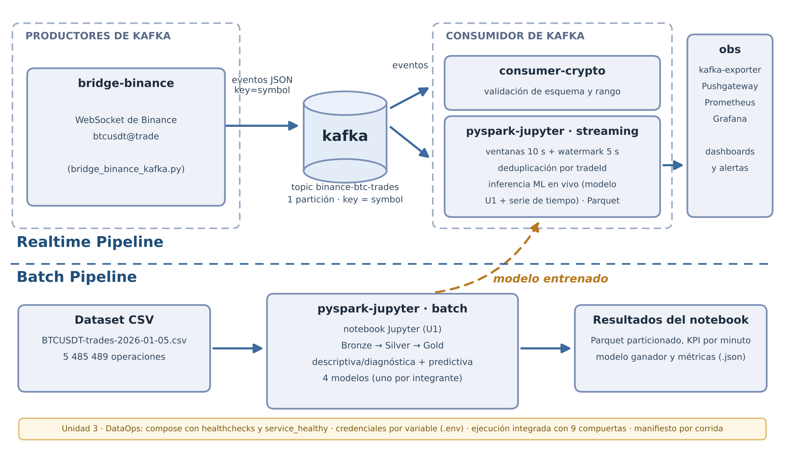

# Arquitectura

Dos rutas separadas. **Lo único que pasa del batch al tiempo real es el modelo entrenado.**

## Componentes

| Componente | Función |
|---|---|
| `bridge-binance` | Lee el WebSocket `btcusdt@trade` y publica en Kafka |
| `kafka` | 1 broker, topic `binance-btc-trades`, 1 partición, key = `symbol` |
| `consumer-crypto` | Valida los mensajes del topic |
| `pyspark-jupyter` | Spark batch y Structured Streaming; notebooks |
| `kafka-exporter` | Métricas del broker para Prometheus |
| `pushgateway` | Recibe las métricas `cripto_*` de los notebooks |
| `prometheus` | Almacena y consulta las métricas |
| `grafana` | Tablero (aprovisionado desde `obs/`) |

## Decisiones técnicas

- **Medallion** (Bronze/Silver/Gold) en Parquet; Gold ML particionado por `is_buyer_maker`.
- **Separación cronológica** train/test (4 387 256 / 1 098 233 filas) para no filtrar el futuro.
- **Ventana de 10 s, watermark de 5 s** y `dropDuplicates` por `tradeId`; checkpoint para reanudar sin duplicar.
- **Pushgateway** conserva el último valor; se mitiga con `cripto_int_ultima_ejecucion_timestamp` y un panel de antigüedad.
- `spark.sql.caseSensitive=true` por las claves del JSON del WebSocket.
