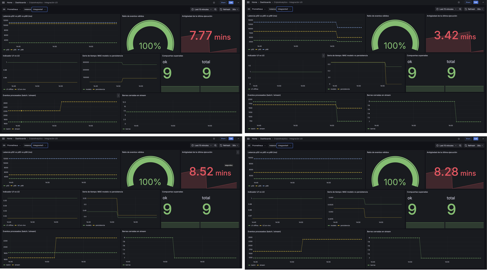

# Pruebas y evidencias

!!! note "Cifras en vivo"
    La fuente de streaming es el WebSocket de Binance, por lo que los valores de U2 y U3 cambian de una ejecución a otra.

## Tablero de integración (segunda corrida)

## Compuertas y no regresión

| Comprobación | Corrida 1 | Corrida 2 |
|---|---|---|
| Compuertas previas | 9 / 9 | 9 / 9 |
| Hardening | 3 / 5 | 5 / 5 |
| Compuerta demostrada fallando | Sí (puerto equivocado) | Sí |

## Latencia evento → Spark (U3, ms)

| Integrante | p50 | p95 | p99 |
|---|---|---|---|
| 1 | 3 018 | 10 709 | 11 152 |
| 2 | 2 673 | 5 025 | 10 759 |
| 3 | 3 249 | 4 914 | 12 050 |
| 4 | 3 045 | 5 125 | 9 697 |

## Indicador U1 frente a U2

| Integrante | Métrica | U1 (offline) | U2 (en vivo) |
|---|---|---|---|
| 1 | R² | 0,9998 | 0,9482 |
| 2 | Recall | 0,9940 | n/d (sin ballenas en la ventana) |
| 3 | AUC-ROC | 0,5548 | 0,5160 |
| 4 | R² | 0,9998 | 0,9656 |

## Serie de tiempo frente a persistencia (MAE modelo / persistencia, U2 en vivo)

| Integrante | Modelo | Persistencia |
|---|---|---|
| 1 | 656 993 | 318 420 |
| 2 | 0,394 | 0,355 |
| 3 | 0,305 | 0,331 |
| 4 | 0,0033 | 0,00347 |

Solo el integrante 3 supera a la persistencia en todas las mediciones. En U3 la muestra es de 7 a 8 barras y no permite concluir.

## Dónde está cada evidencia

- Manifiestos: `artifacts/integranteN/u3/manifiesto_<runId>.json`
- Notebooks ejecutados: `notebooks/`
- Detalle por integrante: [bitácoras](bitacoras/integrante1.md)
